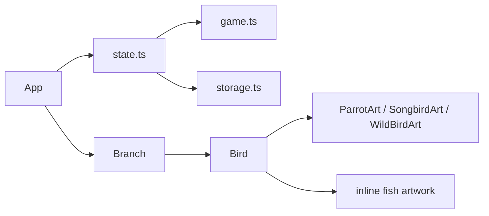

# Bird Sort

A small Expo/React Native sorting puzzle for birds and fish. The web build is a
static site. Run `npm ci`, `npm run web`; verify with `npm test -- --runInBand`
and `npx tsc --noEmit`; produce the web release with `npm run build`.

| File | Responsibility |
| --- | --- |
| `App.tsx`, `Branch.tsx`, `layout.ts`, `Habitat.tsx` | Screen, tap targets, responsive board and decorative habitat |
| `state.ts`, `game.ts` | Progression, moves, undo and solvable level generation |
| `storage.ts` | Persisted progress contract |
| `roster.ts` | Stable bird/fish indices and species definitions |
| `Bird.tsx` | Creature dimensions, animation, bird dispatch and fish rendering |
| `ParrotArt.tsx` | Parrot and cockatoo silhouettes and markings |
| `SongbirdArt.tsx` | Perching birds, dove, woodpecker and hummingbird |
| `WildBirdArt.tsx` | Raptors, waterbirds, owl, toucan and peacock |
| `BirdDetails.tsx` | Shared eye and foot illustration details |
| `scripts/render-bird-gallery.cjs` | Offline contact sheet from actual art components |
| `UpdateBanner.tsx`, `scripts/stamp-version.mjs` | Opt-in update notification and build stamp |

Bird artwork uses a padded 96 × 96 viewBox, fitting inside the existing 48 × 56
logical size. Fish retain their original artwork and viewBox. Species roster
indices are saved data: never reorder or remove entries. New species append.
Art components use solid SVG paths with no new runtime dependencies. The gallery
script uses installed Babel and React tooling for offline review; it is not a
second hand-maintained copy of the art.

The shared feedback package is consumed through its existing package contract.
No credentials belong in the frontend. Keep release operations separate from
art generation; deployment must use the configured host and correct base path.
