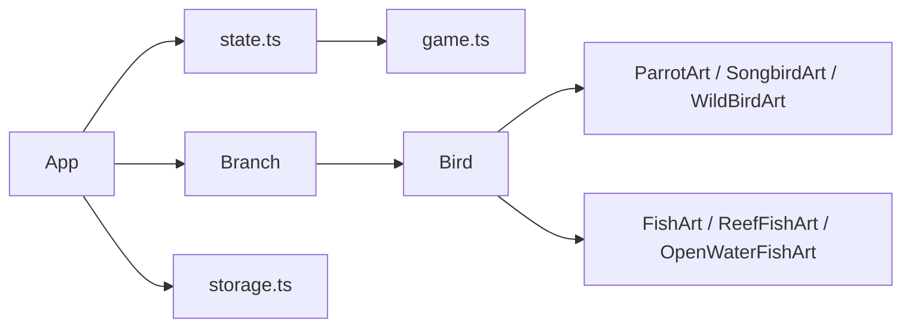

# Bird Sort

A small Expo/React Native sorting puzzle for birds and fish. The web build is a
static site at https://rjfryman.github.io/bird-sort/, served from `gh-pages`. Run `npm ci`, `npm run web`; verify with `npm test -- --runInBand`
and `npx tsc --noEmit`; produce the web release with `npm run build`.

| File | Responsibility |
| --- | --- |
| `App.tsx`, `Branch.tsx`, `layout.ts`, `Habitat.tsx` | Screen, tap targets, responsive board and decorative habitat |
| `state.ts`, `game.ts` | Progression, moves, undo and solvable level generation |
| `storage.ts` | Versioned board, starting deal, difficulty and last-good backup |
| `species-selection.ts` | Exact-count deals excluding visually confusing families |
| `journal.ts`, `DiscoveryJournal.tsx`, `WinCelebration.tsx` | Earned stickers, sourced clues, optional spoken names and win summary |
| `coaching.ts`, `motion.ts` | Optional winning-path help, first-play teaching and reduced-motion preference |
| `ColoringPage.tsx`, `coloring.ts` | Interactive saved coloring from the real SVG tree, printable/downloadable on web |
| `roster.ts` | Stable bird/fish indices and species definitions |
| `Bird.tsx` | Creature dimensions, animation and illustration dispatch |
| `FishArt.tsx`, `ReefFishArt.tsx`, `OpenWaterFishArt.tsx`, `ReefPerch.tsx` |32 stable fish silhouettes, reef/open-water groups and reef ledges |
| `bird-knowledge.ts`, `fish-knowledge.ts` | Short primary-sourced discoveries for all52birds and32fish, fantasy entries explicitly identified |
| `Habitat.tsx` | Quiet grove scenery and underwater reef atmosphere |
| `audio.ts`, `cardinal-recording.ts` | Procedural feedback, asset URLs and original CC0 cardinal provenance |
| `bird-calls.ts`, `bird-recordings.ts`, `bird-recordings.json`, `bird-call-assets.ts`, `BirdCallCredit.tsx` | Single real-call playback, completion,52 roster mappings, bundled assets and journal credits |
| `ParrotArt.tsx` | Parrot and cockatoo silhouettes and markings |
| `SongbirdArt.tsx` | Perching birds, dove, woodpecker and hummingbird |
| `WildBirdArt.tsx` | Raptors, waterbirds, owl, toucan and peacock |
| `BirdDetails.tsx` | Shared eye and foot illustration details |
| `scripts/check-bird-audio.py`, `bird-audio-measurements.json`, `bird-audio-reviewed-windows.json` | Asset-authoring checks, hash-bound measurements and explicitly inspected vocal windows |
| `scripts/render-bird-gallery.cjs` | Offline contact sheet from actual art components |
| `UpdateBanner.tsx`, `scripts/stamp-version.mjs` | Opt-in update notification and build stamp |

Bird artwork uses a padded 96 × 96 viewBox, fitting inside the existing 48 × 56
logical size. Fish now use species-specific silhouettes in the same viewBox. Species roster
indices are saved data: never reorder or remove entries. New species append.
Art components use solid SVG paths with no new runtime dependencies. The gallery
script uses installed Babel and React tooling for offline review; it is not a
second hand-maintained copy of the art.

The shared feedback package is consumed through its existing package contract.
No credentials belong in the frontend. Keep release operations separate from
art generation. `npm run deploy` builds with `/bird-sort/` asset paths and runs
`scripts/deploy-pages.mjs`, which publishes only the static export to the existing
`gh-pages` branch. It never switches the source checkout. Update checks use an
app-relative version URL so the project prefix is preserved.

Game saves retain the original deal and difficulty, migrate existing v1 records
without changing their boards, and retain a last-good backup before each write.
New deals exclude conflicting visual families; saved boards are never remapped.
Discovery stickers are earned only on won boards and never lock gallery access.
Coloring saves are independent of puzzle progress and keyed by creature. Sound
credits live in the corresponding journal entry; audio source and edits are
documented in `docs/cardinal-audio.md`. The normal menu has no grown-up gate.

Jest explicitly resolves React runtime modules from this app. TypeScript's
linked-package declaration mappings are not runtime aliases: Expo tsconfigPaths
is disabled, and Jest's mapper override prevents component tests importing types
as runtime code. No new runtime package was added by the second pass.

The fish roster appends entries11–31 while preserving the original0–10 for saved
boards, stickers and coloring. Easy stays at2–4species; more fish add variety,
not difficulty. Fish facts distinguish the imaginary Green Fish explicitly.
Hard coaching uses bounded depth-first winning paths, cached per exact board;
search exhaustion is distinct from a blocked board and never implies a fresh
solvable puzzle is broken. Compact coaching uses hand/target cues, not invisible
branch numbers. Landscape hides the redundant scroll label during coaching.

Scrollable coaching measures branch rows and the board viewport. Explicit Hint
requests center the source, then the destination after selection; repeating Hint
recenters after manual scrolling. Hand cues render only when their complete row
is visible, so off-screen cues cannot impersonate another row.

Medium is an optional middle rung:4→5→6species with breathers and bounded
reversible scrambles. Easy is unchanged. Difficulty remains a v2 save fact, now
accepting Medium alongside existing Easy/Hard; legacy saves keep their boards.
Dense fish challenges use40px minimum slots and scroll-aware hints. When changed
SVG geometry invalidates earlier coloring, the next write retains the earlier
paint record at the per-species `:previous` key before replacing it.
